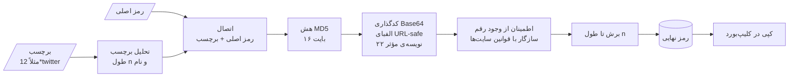
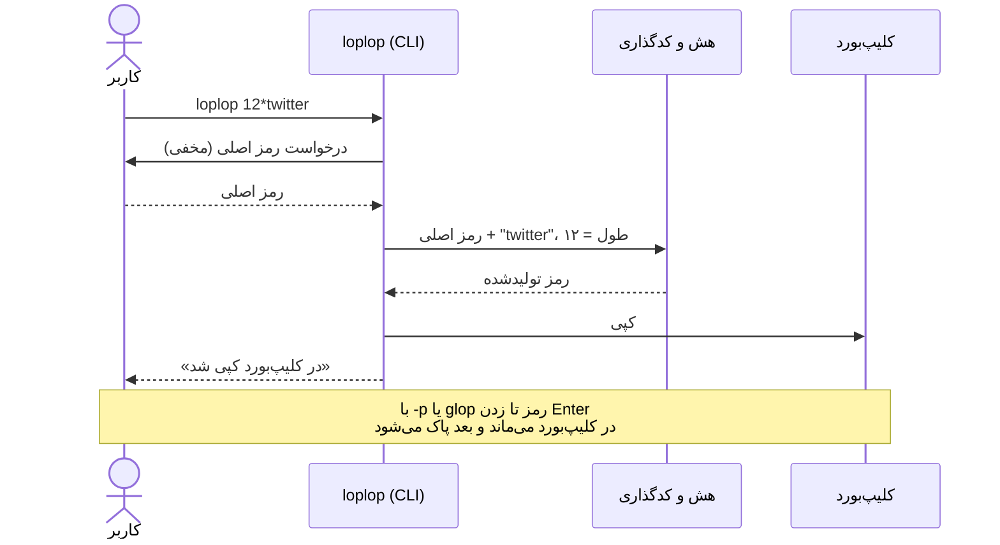
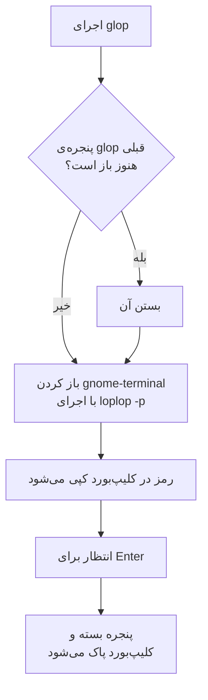

<div dir="rtl" align="right">

# Loplop (لوپلوپ)

> نسخه‌ی قوی‌تر و بلندتر از [Oplop](http://code.google.com/p/oplop/): یک **تولیدکننده‌ی رمز عبور بدون ذخیره‌سازی**.
> یک رمز اصلی + یک برچسب (مثلاً `twitter`) ← یک رمز یکتا و قابل بازتولید برای هر سایت. هیچ چیزی ذخیره یا همگام‌سازی نمی‌شود.


---

## فهرست مطالب

1. [این پروژه چه مشکلی را حل می‌کند؟](#این-پروژه-چه-مشکلی-را-حل-میکند)
2. [نحوه‌ی کار](#نحوهی-کار)
3. [تفاوت با Oplop](#تفاوت-با-oplop)
4. [سینتکس برچسب](#سینتکس-برچسب)
5. [پیاده‌سازی‌ها](#پیادهسازیها)
6. [نصب و استفاده](#نصب-و-استفاده)
7. [نکات امنیتی](#نکات-امنیتی)
8. [منابع و قدردانی](#منابع-و-قدردانی)

---

## این پروژه چه مشکلی را حل می‌کند؟

استفاده از یک رمز برای همه‌جا خطرناک است. به خاطر سپردن صدها رمز متفاوت هم عملاً ممکن نیست. دیتابیس مدیریت‌کننده‌های رمز نیز باید جایی ذخیره و همگام‌سازی شود.

Loplop راه سومی دارد: **رمز را هر بار از نو تولید می‌کند.**

```
رمز اصلی  +  برچسب  ──►  تابع قطعی (deterministic)  ──►  رمز سایت
```

ورودی یکسان همیشه خروجی یکسان می‌دهد. بنابراین **هیچ گاوصندوقی برای دزدیده‌شدن، پشتیبان‌گیری یا همگام‌سازی وجود ندارد.**
فقط یک رمز اصلی و یک برچسب برای هر سایت را به خاطر بسپار و در هر دستگاهی می‌توانی همه‌ی رمزها را بازسازی کنی.

---

## نحوه‌ی کار

### جریان کلی



### گام به گام

| # | گام | توضیح |
|---|------|--------|
| ۱ | **تحلیل برچسب** | پیشوند اختیاری `n*` طول رمز را تعیین می‌کند (پیش‌فرض `16`). |
| ۲ | **ترکیب ورودی‌ها** | رمز اصلی و برچسب به یک رشته تبدیل می‌شوند. |
| ۳ | **هش** | رشته با MD5 هش می‌شود و ۱۶ بایت خروجی می‌دهد. |
| ۴ | **کدگذاری** | خروجی با Base64 (الفبای URL-safe) کدگذاری می‌شود و ۲۲ نویسه‌ی مؤثر دارد. به همین دلیل **حداکثر طول ۲۲** است. |
| ۵ | **قانون رقم** | مانند Oplop، نتیجه طوری تنظیم می‌شود که حداقل یک رقم داشته باشد تا شرط «حتماً عدد داشته باشد» در اکثر سایت‌ها برقرار شود. |
| ۶ | **برش** | نتیجه به طول درخواستی `n` بریده می‌شود. |
| ۷ | **تحویل** | نسخه‌ی CLI رمز را به‌جای نمایش روی صفحه، در کلیپ‌بورد قرار می‌دهد. |

### توالی یک نشست معمولی CLI



### ابزار کمکی `glop` (برای GNOME)



---

## تفاوت با Oplop

| ویژگی | Oplop | Loplop |
|---|---|---|
| طول پیش‌فرض | ۸ نویسه | **۱۶ نویسه** |
| طول دلخواه | ✗ | ✔ با `n*label` |
| حداکثر طول | ۸ | **۲۲** |
| سازگاری با نسخه‌ی قدیمی | – | ✔ (`*label` یعنی ۸ نویسه) |
| حالت توقف و نگه‌داشتن کلیپ‌بورد (`-p`) | ✗ | ✔ |
| اجراکننده‌ی GNOME (`glop`) | ✗ | ✔ |

> رمز ۸ نویسه‌ای فضای جست‌وجوی کوچکی دارد و در برابر حملات brute-force و جدول‌های rainbow آسیب‌پذیر است. طول پیش‌فرض بلندتر هزینه‌ی این حملات را به‌طور محسوسی بالا می‌برد.

---

## سینتکس برچسب

| ورودی | معنی |
|---|---|
| `twitter` | رمز ۱۶ نویسه‌ای برای برچسب `twitter` |
| `12*twitter` | رمز ۱۲ نویسه‌ای |
| `*twitter` | **حالت legacy**: ۸ نویسه و سازگار با Oplop اصلی |
| `8*twitter` | معادل `*twitter` |
| `22*twitter` | حداکثر طول |
| `666*twitter` | معادل `22*twitter` (سقف اعمال می‌شود) |
| `16*3cheers` | پیشوند صریح برای برچسب‌هایی که شبیه پیشوند طول هستند (مثل `*spangled` یا `3*cheers`) |

---

## پیاده‌سازی‌ها

| پلتفرم | نحوه‌ی استفاده |
|---|---|
| **CLI (پایتون)** | اسکریپت `loplop` و در GNOME اسکریپت `glop` |
| **اندروید** | Python-for-Android / SL4A (بخش اندروید ریپو را ببین) |
| **جاوااسکریپت** | فایل `index.html` را در مرورگر باز کن، ترجیحاً روی دستگاهی بدون اینترنت |

---

## نصب و استفاده

### CLI در لینوکس

```bash
git clone https://github.com/GoldenIsland00/loplop.git
cd loplop

# اسکریپت‌ها را در PATH قرار بده
ln -s "$PWD/loplop" ~/bin/loplop
ln -s "$PWD/glop"   ~/bin/glop
```

```bash
loplop twitter        # ۱۶ نویسه
loplop 12*twitter     # ۱۲ نویسه
loplop '*twitter'     # ۸ نویسه، سازگار با Oplop (داخل کوتیشن بگذار تا شل آن را باز نکند)
loplop -p twitter     # رمز تا زدن Enter در کلیپ‌بورد می‌ماند
glop twitter          # همان، ولی در پنجره‌ی gnome-terminal جداگانه
```

### مرورگر

`index.html` را باز کن. همه‌چیز به‌صورت محلی در جاوااسکریپت اجرا می‌شود.

### سایر پلتفرم‌ها

هنوز رسماً پشتیبانی نمی‌شوند. مشارکت شما پذیرفته است.

---

## نکات امنیتی

- **قدرت رمز اصلی همه‌چیز است.** هر کس آن را حدس بزند و برچسب‌هایت را بداند، می‌تواند همه‌ی رمزها را بازسازی کند.
- **برچسب‌ها محرمانه نیستند**، اما ثابت و به‌یادماندنی انتخاب کن و طول‌های غیرپیش‌فرض را یادداشت کن.
- **MD5** برای سازگاری با طراحی Oplop استفاده شده و اینجا نقش مرحله‌ی استخراج کلید را دارد، نه مقاومت در برابر تصادم. جایگزین یک KDF کند و مدرن نیست.
- **روی دستگاه مورد اعتماد اجرا کن**؛ نسخه‌ی وب را ترجیحاً آفلاین.
- محتوای کلیپ‌بورد برای سایر برنامه‌ها قابل خواندن است. از `-p` یا `glop` استفاده کن تا زود پاک شود.
- تغییر الگوریتم یا طول، همه‌ی رمزها را عوض می‌کند. تنظیمات هر سایت را یادداشت کن.

---

## منابع و قدردانی

- بر پایه‌ی **[Oplop](http://code.google.com/p/oplop/)** و توضیحات [How It Works](http://code.google.com/p/oplop/wiki/HowItWorks).
- نسخه‌ی Loplop در اصل از [thedod](https://github.com/thedod/loplop)؛ پیاده‌سازی جاوااسکریپت از israellevin.
- نگهداری در [GoldenIsland00/loplop](https://github.com/GoldenIsland00/loplop).

## مجوز

اطلاعات مجوز را در خود ریپازیتوری ببین.

</div>
