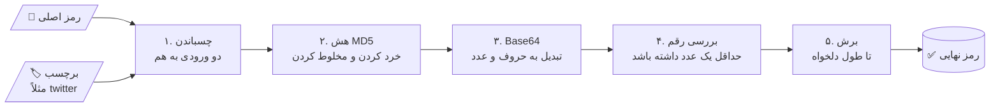
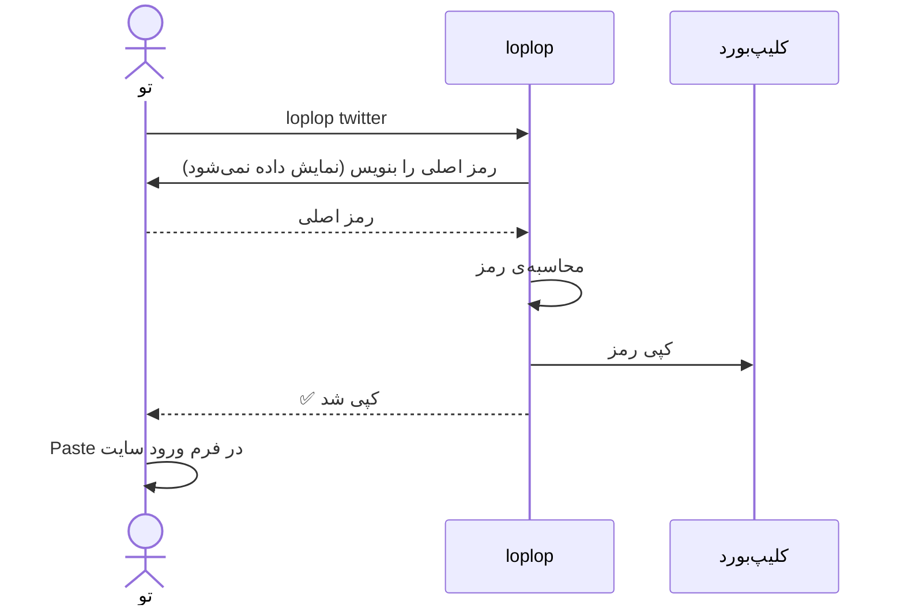
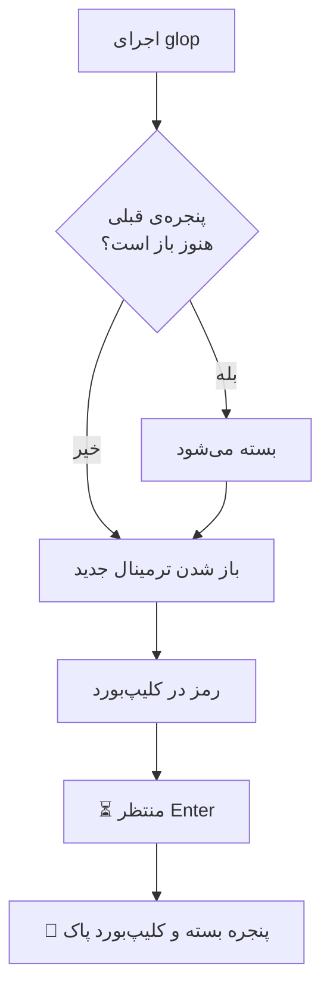

<div dir="rtl" align="right">

# Loplop (لوپلوپ)

### یک رمز را به خاطر بسپار، هزار رمز بساز 🔐

Loplop یک ابزار کوچک است که **برای هر سایت یک رمز عبور قوی می‌سازد، بدون اینکه هیچ رمزی را ذخیره کند.**


---

## فهرست

1. [ایده در یک نگاه](#ایده-در-یک-نگاه)
2. [مشکل چیست؟](#مشکل-چیست)
3. [Loplop چطور مشکل را حل می‌کند؟](#loplop-چطور-مشکل-را-حل-میکند)
4. [داخل جعبه چه می‌گذرد؟](#داخل-جعبه-چه-میگذرد)
5. [یک مثال کامل](#یک-مثال-کامل)
6. [طول رمز را خودت انتخاب کن](#طول-رمز-را-خودت-انتخاب-کن)
7. [تفاوت با Oplop](#تفاوت-با-oplop)
8. [پیاده‌سازی‌ها](#پیادهسازیها)
9. [نصب و استفاده](#نصب-و-استفاده)
10. [سؤال‌های پرتکرار](#سؤالهای-پرتکرار)
11. [نکات امنیتی](#نکات-امنیتی)
12. [منابع و قدردانی](#منابع-و-قدردانی)

---

## ایده در یک نگاه

```
رمز اصلی (فقط در ذهن تو)  +  اسم سایت  ──►  Loplop  ──►  رمز مخصوص همان سایت
```

- رمز اصلی تو را **هیچ‌جا ذخیره نمی‌کند**.
- رمز سایت‌ها را **هیچ‌جا ذخیره نمی‌کند**.
- هر بار که همان دو ورودی را بدهی، **دقیقاً همان رمز** را پس می‌گیری.

یعنی لازم نیست فایل، حساب کاربری، ابر (cloud) یا همگام‌سازی داشته باشی.

---

## مشکل چیست؟

آدم‌ها معمولاً یکی از این سه کار را می‌کنند:

| روش | مشکلش |
|---|---|
| یک رمز برای همه‌جا | اگر یک سایت هک شود، همه‌ی حساب‌هایت در خطرند. |
| رمزهای مختلف و حفظ کردن | عملاً غیرممکن است. معمولاً ساده یا شبیه هم می‌شوند. |
| برنامه‌ی مدیریت رمز | باید فایل رمزها را نگه داری، پشتیبان بگیری و بین دستگاه‌ها همگام کنی. اگر آن فایل لو برود، همه‌چیز لو رفته. |

---

## Loplop چطور مشکل را حل می‌کند؟

مثل یک **دستور پخت** فکر کن.

اگر دستور پخت و مواد یکسان باشند، هر بار همان غذا درمی‌آید. نیازی نیست غذا را نگه داری؛ هر وقت خواستی دوباره می‌پزی.

| در آشپزی | در Loplop |
|---|---|
| مواد اصلی | رمز اصلی تو |
| ادویه‌ی مخصوص هر غذا | برچسب (مثلاً `twitter`) |
| دستور پخت | الگوریتم Loplop |
| غذای آماده | رمز سایت |

اگر برچسب را عوض کنی (مثلاً `gmail`)، یک رمز **کاملاً متفاوت** می‌گیری. و رمز یک سایت از روی رمز سایت دیگر قابل حدس زدن نیست.

---

## داخل جعبه چه می‌گذرد؟

### نمای کلی



### هر مرحله را ساده توضیح بدهیم

**۱. چسباندن (ترکیب ورودی‌ها)**
رمز اصلی و برچسب پشت هم گذاشته می‌شوند و یک متن می‌شوند. مثلاً:
`رمز‌اصلی‌تو` + `twitter`

**۲. هش MD5 (مثل مخلوط‌کن)**
متن را در یک «مخلوط‌کن ریاضی» می‌ریزیم. دو ویژگی مهم دارد:
- ورودی یکسان ← همیشه خروجی یکسان.
- از روی خروجی **نمی‌شود** ورودی را برگرداند. مثل اینکه از روی اسموتی بخواهی بفهمی چه میوه‌هایی ریخته‌اند.

اگر فقط یک حرف ورودی عوض شود، خروجی کاملاً فرق می‌کند.

**۳. Base64 (تبدیل به نویسه‌های قابل‌تایپ)**
خروجی هش یک عدد خام است. Base64 آن را به حروف بزرگ و کوچک، عدد و چند علامت تبدیل می‌کند تا بشود به‌عنوان رمز استفاده کرد. نتیجه ۲۲ نویسه‌ی مفید دارد؛ به همین دلیل بیشترین طول رمز در Loplop **۲۲** است.

**۴. بررسی رقم**
بعضی سایت‌ها می‌گویند «رمز باید حتماً عدد داشته باشد». برای همین، مثل Oplop اصلی، مطمئن می‌شویم رمز نهایی حداقل یک رقم دارد.

**۵. برش**
نتیجه به طولی که خواسته‌ای بریده می‌شود (پیش‌فرض ۱۶ نویسه).

**۶. تحویل**
رمز روی صفحه چاپ نمی‌شود؛ مستقیم به **کلیپ‌بورد** می‌رود تا کسی از پشت سرت نبیندش. فقط کافی است در فرم سایت Paste کنی.

### ماجرا از دید تو



### ابزار `glop`؛ نسخه‌ی راحت‌تر برای GNOME

`glop` همان `loplop` است، ولی:
- خودش یک پنجره‌ی ترمینال باز می‌کند،
- رمز را در کلیپ‌بورد نگه می‌دارد،
- وقتی Enter بزنی، **پنجره بسته و کلیپ‌بورد پاک می‌شود**.



---

## یک مثال کامل

فرض کن رمز اصلی‌ات یک جمله‌ی طولانی و فقط مخصوص خودت است.

| سایت | چه می‌نویسی | چه می‌گیری |
|---|---|---|
| توییتر | `loplop twitter` | یک رمز ۱۶ نویسه‌ای مخصوص توییتر |
| جیمیل | `loplop gmail` | یک رمز کاملاً متفاوت برای جیمیل |
| بانک | `loplop 20*bank` | یک رمز ۲۰ نویسه‌ای برای بانک |

نکته‌ها:
- **سه رمز بالا هیچ شباهتی به هم ندارند.** لو رفتن یکی، بقیه را لو نمی‌دهد.
- **فردا یا یک سال بعد**، روی هر کامپیوتر دیگری هم همین دستورها را بزنی، همین رمزها را می‌گیری.
- اگر لپ‌تاپت گم شود، چیزی از دست نرفته. دوباره Loplop را نصب می‌کنی و کار تمام است.

---

## طول رمز را خودت انتخاب کن

با گذاشتن `عدد*` قبل از برچسب، طول را تعیین می‌کنی:

| می‌نویسی | یعنی |
|---|---|
| `twitter` | ۱۶ نویسه (پیش‌فرض) |
| `12*twitter` | ۱۲ نویسه |
| `22*twitter` | ۲۲ نویسه (بیشترین) |
| `666*twitter` | چون بیش از سقف است، مثل ۲۲ حساب می‌شود |
| `*twitter` | **حالت قدیمی**: ۸ نویسه، سازگار با Oplop اصلی |
| `8*twitter` | همان `*twitter` |

**چرا گاهی `16*` صریح می‌نویسیم؟**
اگر اسم برچسب خودش شبیه پیشوند باشد (مثل `3*cheers` یا `*spangled`)، برنامه گیج می‌شود. در این حالت جلویش `16*` بگذار تا معلوم شود «این برچسب خود اسم است».

> 💡 توصیه: برای هر سایتی که طول غیرپیش‌فرض گذاشتی، یک یادداشت کوچک (خارج از رمز اصلی) نگه دار؛ چون طول متفاوت یعنی رمز متفاوت.

---

## تفاوت با Oplop

Loplop نسخه‌ی تغییریافته‌ی Oplop است. اصلی‌ترین تفاوت: **رمزهای بلندتر و امن‌تر**.

| ویژگی | Oplop | Loplop |
|---|---|---|
| طول پیش‌فرض | ۸ نویسه | **۱۶ نویسه** |
| انتخاب طول دلخواه | ✗ | ✔ |
| بیشترین طول | ۸ | **۲۲** |
| حالت سازگار با قدیم | – | ✔ (`*label`) |
| نگه‌داشتن رمز در کلیپ‌بورد تا Enter (`-p`) | ✗ | ✔ |
| اجراکننده‌ی GNOME (`glop`) | ✗ | ✔ |

**چرا ۸ نویسه کم است؟**
تعداد حالت‌های ممکن برای ۸ نویسه آنقدر کم است که مهاجم می‌تواند همه را امتحان کند (brute-force) یا از جدول‌های از پیش‌ساخته (rainbow table) استفاده کند. ۱۶ نویسه این کار را بسیار سخت‌تر می‌کند.

---

## پیاده‌سازی‌ها

| پلتفرم | چطور استفاده کنم؟ |
|---|---|
| **ترمینال (پایتون)** | اسکریپت `loplop` و در GNOME اسکریپت `glop` |
| **اندروید** | با Python-for-Android یا SL4A (بخش اندروید ریپو) |
| **مرورگر (جاوااسکریپت)** | فایل `index.html` را باز کن. ترجیحاً روی دستگاه آفلاین |

---

## نصب و استفاده

### لینوکس (ترمینال)

```bash
git clone https://github.com/GoldenIsland00/loplop.git
cd loplop

# اسکریپت‌ها را در PATH بگذار تا از هر جا اجرا شوند
ln -s "$PWD/loplop" ~/bin/loplop
ln -s "$PWD/glop"   ~/bin/glop
```

```bash
loplop twitter        # رمز ۱۶ نویسه‌ای
loplop 12*twitter     # رمز ۱۲ نویسه‌ای
loplop '*twitter'     # رمز ۸ نویسه‌ای قدیمی (کوتیشن بگذار تا شل ستاره را تفسیر نکند)
loplop -p twitter     # رمز تا زدن Enter در کلیپ‌بورد می‌ماند
glop twitter          # همان، در پنجره‌ی جداگانه
```

### مرورگر

فقط `index.html` را باز کن. هیچ چیزی به اینترنت فرستاده نمی‌شود؛ محاسبه کاملاً روی دستگاه خودت انجام می‌شود.

### سیستم‌عامل‌های دیگر

هنوز رسمی نیستند. اگر می‌توانی، مشارکت کن.

---

## سؤال‌های پرتکرار

**اگر رمز اصلی‌ام را فراموش کنم؟**
هیچ راه بازیابی‌ای وجود ندارد؛ چون هیچ‌جا ذخیره نشده. پس آن را جمله‌ای انتخاب کن که هم قوی باشد و هم به یاد بماند.

**اگر سایتی بخواهد رمزم را عوض کنم؟**
یک برچسب جدید بساز، مثلاً `twitter2` یا `twitter-2027`.

**اینترنت لازم است؟**
خیر. همه‌چیز محلی انجام می‌شود.

**می‌شود رمزهایم را در گوشی و لپ‌تاپ یکسان داشته باشم؟**
بله. فقط باید رمز اصلی و برچسب (و طول) هر دو جا یکی باشد.

**رمز را می‌شود از روی خروجی به رمز اصلی برگرداند؟**
نه، مرحله‌ی هش یک‌طرفه است.

---

## نکات امنیتی

- 🔑 **رمز اصلی مهم‌ترین چیز است.** آن را طولانی و مخصوص خودت بساز و با هیچ سایتی مشترک نکن.
- 🏷️ برچسب‌ها محرمانه نیستند، ولی ثابت و قابل‌یادآوری انتخاب کن.
- 🧮 MD5 برای سازگاری با طراحی Oplop استفاده شده. برای ساخت رمز از ورودی‌های قوی خوب است، ولی جای الگوریتم‌های مدرن و کند (مثل Argon2) را نمی‌گیرد.
- 💻 فقط روی دستگاه مورد اعتماد استفاده کن؛ نسخه‌ی وب را ترجیحاً آفلاین.
- 📋 برنامه‌های دیگر می‌توانند کلیپ‌بورد را بخوانند. از `-p` یا `glop` استفاده کن تا رمز سریع پاک شود.
- ⚠️ تغییر طول یا الگوریتم = تغییر همه‌ی رمزها. تنظیمات هر سایت را یادداشت کن.

---

## منابع و قدردانی

- بر پایه‌ی **[Oplop](http://code.google.com/p/oplop/)** و توضیحات [How It Works](http://code.google.com/p/oplop/wiki/HowItWorks).
- نسخه‌ی Loplop در اصل از [thedod](https://github.com/thedod/loplop)؛ پیاده‌سازی جاوااسکریپت از israellevin.
- نگهداری در [GoldenIsland00/loplop](https://github.com/GoldenIsland00/loplop).

## مجوز

اطلاعات مجوز را در خود ریپازیتوری ببین.

</div>
