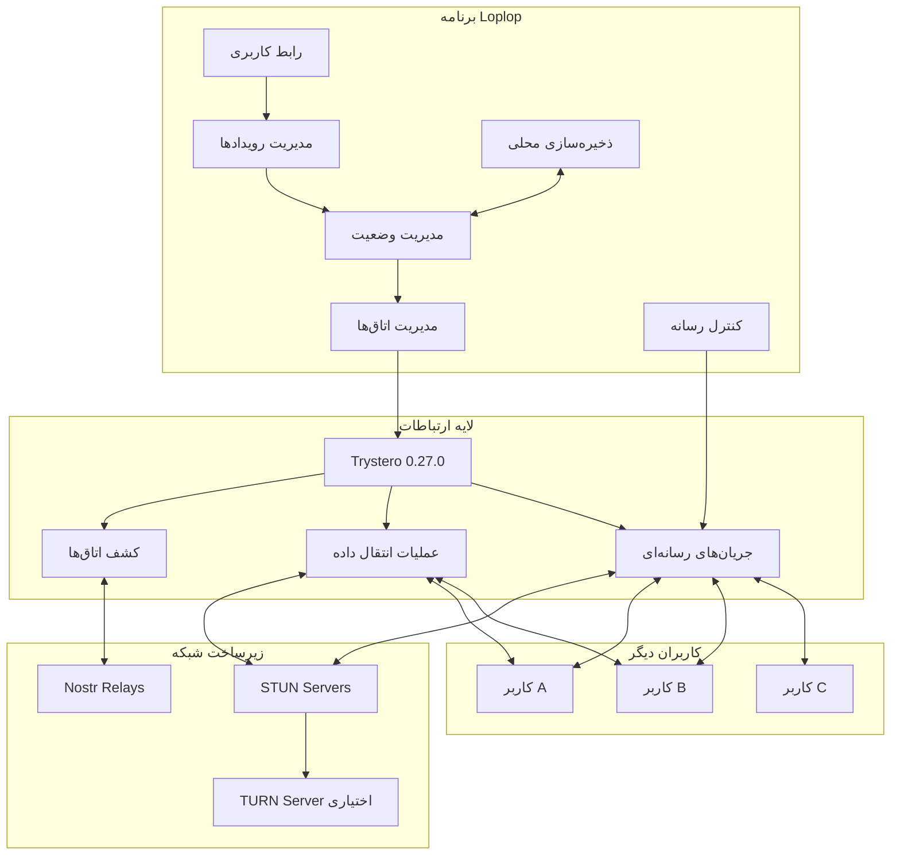
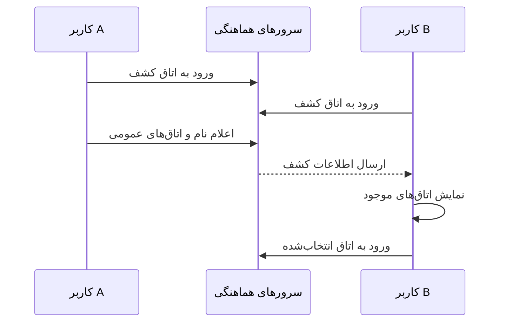
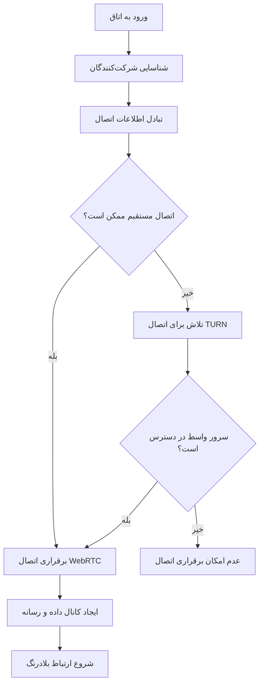
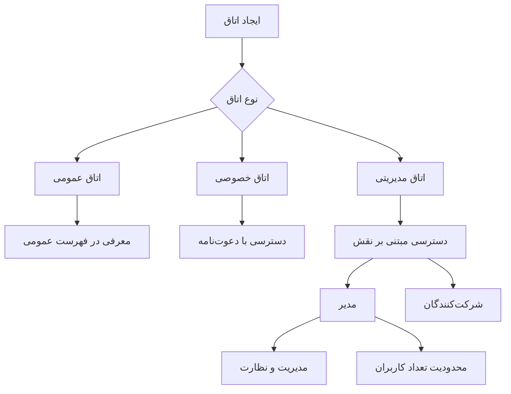
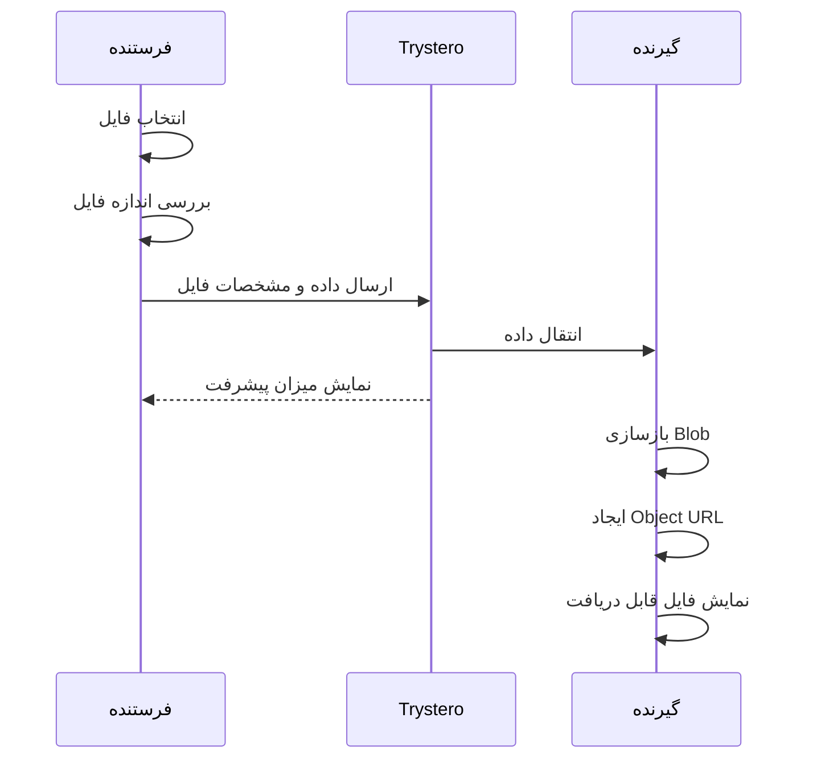
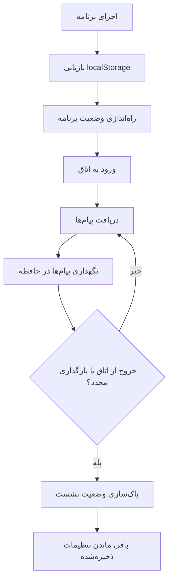

# Loplop — سامانه ارتباطی همتابه‌همتا (Peer-to-Peer)

<p align="center">
  <strong>یک پلتفرم ارتباطی مبتنی بر مرورگر با معماری ارتباط مستقیم و غیرمتمرکز</strong>
</p>

<p align="center">
  
  
  
  
  
  
</p>

---

## ۰۱. معرفی پروژه

**Loplop** یک سامانه ارتباطی مبتنی بر مرورگر است که با هدف ایجاد ارتباط مستقیم میان کاربران و بدون وابستگی به یک سرور مرکزی متداول برای مدیریت پیام‌ها طراحی شده است.

این پروژه یک محیط ارتباطی یکپارچه ارائه می‌دهد که از قابلیت‌هایی مانند اتاق‌های گفت‌وگو، ارسال پیام متنی، انتقال فایل، پیام صوتی، ارتباط صوتی و تصویری و اشتراک‌گذاری صفحه نمایش پشتیبانی می‌کند.

معماری Loplop بر اساس تفکیک دو مفهوم اصلی طراحی شده است:

1. کشف کاربران و هماهنگی اولیه برای برقراری ارتباط.
2. انتقال مستقیم داده‌ها و محتوای ارتباطی میان کاربران.

به‌جای ارسال تمام پیام‌ها از طریق یک سرور مرکزی، Loplop از ارتباطات مبتنی بر WebRTC استفاده می‌کند و کتابخانه Trystero وظیفه هماهنگی اتاق‌ها و ساده‌سازی ارتباط میان همتاها را بر عهده دارد.

نتیجه این معماری، یک برنامه سبک مبتنی بر HTML، CSS و JavaScript است که می‌تواند به‌صورت یک وب‌سایت ایستا میزبانی شود و امکانات ارتباطی بلادرنگ ارائه دهد.

### اصل بنیادین معماری

**هماهنگی ارتباطات توزیع‌شده است؛ انتقال داده‌ها تا حد امکان مستقیم و همتابه‌همتا انجام می‌شود.**

این برنامه برای ذخیره مکالمات، مدیریت حساب‌های کاربری یا پردازش پیام‌ها به یک بک‌اند اختصاصی نیاز ندارد.

بااین‌حال، بسته به شرایط شبکه، برای کشف همتاها و برقراری اتصال ممکن است به زیرساخت‌های خارجی نیاز باشد.

---

## ۰۲. قابلیت‌های اصلی

| بخش | فناوری | عملکرد |
|---|---|---|
| مدیریت اتاق‌ها | Trystero | ایجاد، ورود و مدیریت اتاق‌ها |
| کشف اتاق‌ها | Shared Lobby | شناسایی اتاق‌های عمومی |
| پیام متنی | Data Channels | ارتباط متنی بلادرنگ |
| ویرایش پیام | Custom Actions | همگام‌سازی تغییرات پیام |
| حذف پیام | Custom Actions | همگام‌سازی حذف پیام |
| واکنش به پیام | Custom Actions | واکنش با ایموجی |
| پاسخ به پیام | Message Metadata | ارجاع به پیام‌های قبلی |
| انتقال فایل | Trystero Actions | انتقال مستقیم فایل |
| پیام صوتی | MediaRecorder | ضبط و ارسال صدا |
| ارتباط صوتی | WebRTC Media | مکالمه صوتی بلادرنگ |
| ارتباط تصویری | WebRTC Media | پخش تصویر دوربین |
| اشتراک صفحه | getDisplayMedia | اشتراک صفحه نمایش |
| مدیریت اتاق | Trystero Roles | نقش‌های مدیریتی و نظارت |
| اتصال شبکه | STUN / TURN | عبور از محدودیت‌های شبکه |
| اعلان‌ها | Notification API | نمایش اعلان دسکتاپ |
| تنظیمات محلی | localStorage | ذخیره تنظیمات برنامه |

### امکانات ارتباطی

- ایجاد و مدیریت چندین اتاق به‌صورت هم‌زمان.
- اتاق‌های عمومی و خصوصی.
- امکان تعریف رمز عبور برای اتاق.
- انتخاب نام نمایشی کاربران.
- لینک دعوت به اتاق.
- کشف و جست‌وجوی اتاق‌های عمومی.
- نمایش وضعیت حضور کاربران.
- نمایش وضعیت تایپ کردن.
- پاسخ به پیام‌ها.
- ویرایش و حذف پیام‌ها.
- واکنش با ایموجی.
- انتقال فایل همراه با نمایش میزان پیشرفت.
- ضبط و ارسال پیام صوتی.
- تماس صوتی و تصویری.
- اشتراک‌گذاری صفحه نمایش.
- نمایش وضعیت اتصال و تأخیر شبکه.
- اعلان دسکتاپ و صدای دریافت پیام.

---

## ۰۳. معماری کلی سامانه

Loplop از یک معماری سمت کاربر با لایه ارتباطی توزیع‌شده استفاده می‌کند.

سه بخش اصلی معماری عبارت‌اند از:

1. **لایه برنامه:** مدیریت رابط کاربری، تعاملات کاربر، اتاق‌ها و وضعیت پیام‌ها.
2. **لایه ارتباطات:** استفاده از Trystero برای هماهنگی اتاق‌ها و مدیریت ارتباطات داده‌ای و رسانه‌ای.
3. **لایه شبکه:** استفاده از WebRTC برای ارتباط مستقیم و بهره‌گیری از STUN و TURN در صورت نیاز.

### نمودار معماری



در این معماری، زیرساخت کشف و هماهنگی ارتباطات از مسیر انتقال واقعی داده‌ها جدا شده است.

از Nostr Relay برای هماهنگی و کشف کاربران استفاده می‌شود؛ این زیرساخت قرار نیست نقش پایگاه داده مکالمات را ایفا کند.

---

## ۰۴. چرخه برقراری ارتباط

فرآیند برقراری ارتباط در Loplop شامل چند مرحله اصلی است.

### مرحله اول: راه‌اندازی برنامه

هنگام بارگذاری سند HTML:

- رابط کاربری راه‌اندازی می‌شود.
- ماژول Trystero بارگذاری می‌شود.
- تنظیمات ذخیره‌شده بازیابی می‌شوند.
- وضعیت اولیه برنامه ایجاد می‌شود.
- زیرساخت کشف اتاق‌ها آماده می‌شود.

شناسه‌های اصلی برنامه:

```javascript
const APP_ID = 'secure-p2p-chat-full-v1';
const LOBBY_ID = '__lobby__';
const MAX_FILE = 50 * 1024 * 1024;
```

متغیر `APP_ID` برای شناسایی برنامه در لایه ارتباطی استفاده می‌شود و `LOBBY_ID` شناسه اتاق عمومی کشف کاربران است.

### مرحله دوم: کشف اتاق‌ها

برنامه می‌تواند برای شناسایی اتاق‌های عمومی به یک اتاق مشترک یا Lobby متصل شود.

هر کاربر متصل می‌تواند نام نمایشی خود و فهرستی محدود از اتاق‌های عمومی قابل شناسایی را اعلام کند.

اطلاعات اعلام‌شده شامل شناسه اتاق‌ها و تعداد کاربران است.



قابلیت کشف اتاق‌ها می‌تواند از طریق تنظیمات برنامه فعال یا غیرفعال شود.

اتاق‌های خصوصی و اتاق‌های دارای رمز عبور در فهرست عمومی اعلام نمی‌شوند.

### مرحله سوم: ورود به اتاق

مدیریت اتاق‌ها از متد `joinRoom()` کتابخانه Trystero استفاده می‌کند.

```javascript
const cfg = {
    appId: APP_ID,
    ...getRtcConfig()
};

if (password) {
    cfg.password = password;
}

const room = joinRoom(cfg, roomId);
```

پس از ورود، برنامه شناسه کاربر محلی را دریافت کرده و یک زمینه ارتباطی مستقل برای اتاق ایجاد می‌کند.

هر اتاق وضعیت اختصاصی خود را نگهداری می‌کند:

- شناسه اتاق.
- فهرست شرکت‌کنندگان.
- مجموعه پیام‌ها.
- وضعیت تایپ کاربران.
- عناصر رسانه‌ای.
- تعداد پیام‌های خوانده‌نشده.
- پیش‌نویس پیام.
- عملیات ارتباطی.
- وضعیت اتصال.

به این ترتیب، برنامه می‌تواند چند اتاق را به‌صورت هم‌زمان مدیریت کند.

### مرحله چهارم: ایجاد اتصال میان کاربران

Trystero هماهنگی کشف کاربران و برقراری ارتباط WebRTC را مدیریت می‌کند.

در صورت امکان، ارتباط مستقیماً میان کاربران ایجاد می‌شود. اگر اتصال مستقیم امکان‌پذیر نباشد، امکان استفاده از TURN برای انتقال داده از مسیر واسط وجود دارد.



جزئیات مذاکره اتصال و انتقال داده توسط Trystero و پیاده‌سازی WebRTC در مرورگر مدیریت می‌شود.

---

## ۰۵. معماری اتاق‌ها

اتاق‌ها مرز اصلی ارتباط میان کاربران در Loplop هستند.

سامانه از چند نوع پیکربندی اتاق پشتیبانی می‌کند.

### اتاق عمومی

اتاق عمومی می‌تواند از طریق Lobby معرفی شود.

کاربران می‌توانند اتاق‌های موجود را مشاهده کرده و بدون نیاز به دعوت‌نامه خصوصی به آن‌ها وارد شوند.

### اتاق خصوصی

اتاق خصوصی در فهرست عمومی معرفی نمی‌شود و ورود به آن از طریق اطلاعات دعوت انجام می‌شود.

همچنین امکان تعریف رمز عبور اختیاری برای اتاق وجود دارد.

### اتاق مدیریتی

Loplop از افزونه Roles در Trystero استفاده می‌کند.

قابلیت‌های مدیریتی شامل موارد زیر است:

- هویت مدیریتی.
- مدیریت شرکت‌کنندگان.
- مسدودسازی کاربران.
- تعیین حداکثر تعداد شرکت‌کنندگان.
- شناسه‌های دارای اطلاعات نقش مدیریتی.

در اتاق‌های مدیریتی، شناسه اتاق از پسوند `~` مرتبط با شناسه مدیر استفاده می‌کند.



مدیریت اتاق مسئول ورود، جابه‌جایی، نگهداری وضعیت و خروج از نشست‌های ارتباطی است.

---

## ۰۶. پروتکل ارتباطی

برنامه انواع مختلف ارتباط را از طریق عملیات مستقل Trystero مدیریت می‌کند.

برای هر اتاق پنج عملیات ارتباطی تعریف می‌شود:

```javascript
ctx.act.chat = room.makeAction('chat');
ctx.act.file = room.makeAction('file');
ctx.act.voice = room.makeAction('voice');
ctx.act.typing = room.makeAction('typing');
ctx.act.mod = room.makeAction('mod');
```

### مسئولیت عملیات‌ها

| عملیات | مسئولیت |
|---|---|
| `chat` | پیام متنی و ارجاع به پیام دیگر |
| `file` | انتقال داده‌های فایل |
| `voice` | انتقال پیام صوتی |
| `typing` | اعلام وضعیت تایپ |
| `mod` | ویرایش، حذف و واکنش به پیام |

این تفکیک باعث می‌شود هر نوع عملیات ارتباطی به‌صورت منطقی مستقل مدیریت شود.

### ساختار پیام متنی

یک پیام متنی خروجی شامل اطلاعات زیر است:

```javascript
{
    id: "unique-message-id",
    text: "Message content",
    ts: Date.now(),
    replyTo: null
}
```

ویژگی `replyTo` زمانی استفاده می‌شود که پیام به پیام دیگری پاسخ داده باشد.

پیام‌های دریافتی پیش از اضافه شدن به وضعیت محلی اتاق، اعتبارسنجی و یکسان‌سازی می‌شوند.

حداکثر طول پیام متنی در برنامه ۴۰۰۰ کاراکتر است.

### همگام‌سازی تغییرات پیام

عملیات ویرایش، حذف و واکنش از طریق عملیات `mod` منتقل می‌شوند.

نمونه ویرایش:

```javascript
{
    type: "edit",
    id: "message-id",
    text: "Updated content"
}
```

نمونه حذف:

```javascript
{
    type: "delete",
    id: "message-id"
}
```

نمونه واکنش:

```javascript
{
    type: "react",
    id: "message-id",
    emoji: "👍"
}
```

هر پیام شناسه منحصربه‌فردی دارد تا تغییرات دقیقاً به پیام موردنظر اعمال شوند.

این عملیات‌ها به‌صورت رویدادهای سطح برنامه همگام‌سازی می‌شوند و جایگزین یک پایگاه داده دائمی پیام نیستند.

### محدودیت ارسال پیام

در کنترل ارسال پیام، محدودکننده نرخ در سمت کاربر پیاده‌سازی شده است.

محدودیت فعلی:

- حداکثر ۸ پیام.
- در بازه زمانی ۱۰ ثانیه.
- برای هر زمینه ارتباطی اتاق.

این محدودیت از ارسال بیش‌ازحد سریع پیام از طریق رابط معمول برنامه جلوگیری می‌کند.

---

## ۰۷. معماری انتقال فایل

انتقال فایل از طریق عملیات اختصاصی `file` انجام می‌شود.

فرستنده فایل را همراه با اطلاعاتی مانند نام، اندازه و نوع MIME ارسال می‌کند.

```javascript
await ctx.act.file.send(file, {
    metadata: {
        name: file.name,
        size: file.size,
        type: file.type
    },
    onProgress: p => showProgress(toPct(p))
});
```

کاربر دریافت‌کننده داده باینری را به یک `Blob` در مرورگر تبدیل می‌کند.

```javascript
const blob = new Blob([data], {
    type: mime
});

const url = URL.createObjectURL(blob);
```

آدرس ایجادشده برای دسترسی و دریافت فایل استفاده می‌شود.

### جریان انتقال فایل



### محدودیت‌های فایل

| ویژگی | مقدار |
|---|---|
| حداکثر حجم فایل خروجی | ۵۰ مگابایت |
| حداکثر حجم فایل ورودی | ۵۰ مگابایت |
| اطلاعات فایل | نام، اندازه و MIME |
| نمایش پیشرفت | پشتیبانی می‌شود |
| نمایش داده باینری | Blob |
| ذخیره دائمی فایل | پیاده‌سازی نشده است |

برنامه اندازه فایل ورودی را نیز با محدودیت تعریف‌شده بررسی می‌کند.

---

## ۰۸. پیام‌های صوتی

پیام‌های صوتی با استفاده از API استاندارد `MediaRecorder` مرورگر پیاده‌سازی شده‌اند.

فرآیند ضبط شامل مراحل زیر است:

1. درخواست مجوز میکروفون.
2. دریافت جریان صوتی.
3. انتخاب قالب ضبط پشتیبانی‌شده.
4. ایجاد نمونه MediaRecorder.
5. جمع‌آوری قطعات صوتی.
6. ساخت Blob.
7. ارسال ضبط از طریق عملیات `voice`.

قالب‌های صوتی ترجیحی برنامه عبارت‌اند از:

- WebM با کدک Opus.
- WebM.
- MP4.
- Ogg.

نمونه راه‌اندازی ضبط:

```javascript
const recorder = new MediaRecorder(stream, {
    mimeType: mime
});
```

مدت زمان ضبط به حدود ۶۰ ثانیه محدود شده است.

در سمت دریافت‌کننده، فایل صوتی به Blob تبدیل شده و از طریق عنصر صوتی مرورگر پخش می‌شود.

---

## ۰۹. ارتباط صوتی و تصویری بلادرنگ

ارتباط صوتی و تصویری از قابلیت‌های داخلی مرورگر و مدیریت جریان‌های Trystero استفاده می‌کند.

### دریافت رسانه

برنامه از API زیر استفاده می‌کند:

```javascript
navigator.mediaDevices.getUserMedia()
```

تنظیمات پردازش صوت شامل موارد زیر است:

- حذف پژواک.
- کاهش نویز.
- تنظیم خودکار سطح صدا.

درخواست تصویری برنامه دارای وضوح مطلوب ۱۲۸۰ در ۷۲۰ پیکسل است.

### کنترل رسانه

کاربران می‌توانند موارد زیر را به‌صورت مستقل کنترل کنند:

- میکروفون.
- دوربین.
- اشتراک‌گذاری صفحه.

### اشتراک‌گذاری صفحه نمایش

اشتراک صفحه از طریق API زیر انجام می‌شود:

```javascript
navigator.mediaDevices.getDisplayMedia({
    video: { cursor: 'always' },
    audio: true
});
```

جریان ایجادشده با متادیتای مشخص به اتاق اضافه می‌شود:

```javascript
await room.addStream(stream, {
    metadata: {
        type: 'screen'
    }
});
```

کاربر دریافت‌کننده نوع جریان را از طریق متادیتا شناسایی کرده و آن را در رابط رسانه‌ای نمایش می‌دهد.

### مدیریت چرخه عمر رسانه

برنامه جریان‌های رسانه‌ای محلی و کاربران دیگر را به‌صورت مستقل مدیریت می‌کند.

هنگامی که کاربر از اتاق خارج می‌شود یا زمینه رسانه‌ای فعال را تغییر می‌دهد، Trackهای مرتبط آزاد شده و عناصر رسانه‌ای مربوطه حذف می‌شوند.

این کار از فعال ماندن غیرضروری جریان‌های رسانه‌ای جلوگیری می‌کند.

---

## ۱۰. زیرساخت شبکه

Loplop به یک سرور اختصاصی برای اجرای منطق اصلی برنامه نیاز ندارد؛ اما برقراری ارتباط واقعی میان کاربران همچنان به زیرساخت شبکه وابسته است.

### STUN

STUN به کاربران کمک می‌کند آدرس‌های شبکه قابل دسترس خود را شناسایی کنند.

این فناوری در ایجاد اتصال مستقیم WebRTC در بسیاری از شرایط NAT کاربرد دارد.

### TURN

در شرایطی که اتصال مستقیم میان کاربران امکان‌پذیر نباشد، TURN می‌تواند به‌عنوان مسیر واسط انتقال داده عمل کند.

Loplop امکان تنظیم اطلاعات TURN را از طریق تنظیمات ارتباطی فراهم می‌کند.

موارد قابل تنظیم:

- آدرس سرور TURN.
- نام کاربری TURN.
- رمز عبور TURN.
- حالت اجبار استفاده از Relay.

نمونه تنظیمات:

```javascript
const rtcConfig = {
    urls: "turn:turn.example.com:3478",
    username: "username",
    credential: "password"
};
```

این نمونه صرفاً ساختار موردنیاز تنظیمات را نشان می‌دهد و مقادیر آن باید با اطلاعات سرور واقعی جایگزین شوند.

### محدودیت‌های شبکه

اتصال مستقیم ممکن است در شرایط زیر با مشکل مواجه شود:

- Symmetric NAT.
- فایروال‌های محدودکننده سازمانی.
- برخی شبکه‌های تلفن همراه.
- شبکه‌های Wi-Fi محدودشده.
- برخی تنظیمات VPN.

استفاده از یک سرویس TURN فعال می‌تواند احتمال برقراری ارتباط در این شرایط را افزایش دهد.

---

## ۱۱. مدیریت وضعیت و ذخیره‌سازی

Loplop از مدل مدیریت وضعیت در حافظه و ذخیره‌سازی محلی مرورگر استفاده می‌کند.

### وضعیت در حافظه

ساختار اصلی وضعیت برنامه:

```javascript
const S = {
    nickname: '',
    rooms: new Map(),
    activeId: null,
    tab: 'mine',
    lobby: null,
    joining: new Set(),
    replyTo: null,
    lastPings: []
};
```

هر اتاق زمینه ارتباطی اختصاصی خود را دارد.

این طراحی امکان جابه‌جایی میان اتاق‌ها را بدون ادغام مجموعه پیام‌ها یا وضعیت شرکت‌کنندگان فراهم می‌کند.

### ذخیره‌سازی محلی

لایه ذخیره‌سازی از `localStorage` مرورگر استفاده می‌کند.

```javascript
const store = {
    get(key, defaultValue) {
        try {
            const value = localStorage.getItem(key);

            return value == null
                ? defaultValue
                : JSON.parse(value);
        } catch {
            return defaultValue;
        }
    },

    set(key, value) {
        try {
            localStorage.setItem(
                key,
                JSON.stringify(value)
            );
        } catch {}
    }
};
```

اطلاعات ذخیره‌شده شامل موارد زیر است:

- نام نمایشی کاربر.
- ارجاع به اتاق‌های اخیر.
- تنظیمات TURN.
- تنظیمات اعلان‌ها.
- محدودیت پیش‌فرض شرکت‌کنندگان.
- تنظیمات کشف اتاق‌ها.
- آدرس پایه دعوت‌نامه.

اطلاعات اعتبارنامه TURN نیز بخشی از تنظیمات محلی هستند.

### چرخه عمر اطلاعات



**نکته مهم:** تاریخچه پیام‌ها در حال حاضر در IndexedDB یا یک لایه ذخیره‌سازی دائمی دیگر ذخیره نمی‌شود. با بارگذاری مجدد صفحه یا خروج از اتاق، تاریخچه مکالمات موجود در حافظه از بین می‌رود.

---

## ۱۲. مدل امنیتی

مدل امنیتی Loplop بر کاهش وابستگی به ذخیره‌سازی متمرکز اطلاعات و استفاده از قابلیت‌های ارتباطی مرورگر استوار است.

### امنیت انتقال داده

WebRTC برای انتقال امن داده‌ها از DTLS و برای ارتباطات رسانه‌ای از سازوکارهای رمزنگاری مربوط به WebRTC استفاده می‌کند.

مستندات فنی برنامه همچنین به مکانیزم شناسایی هویت و مدیریت نقش از طریق Trystero اشاره می‌کنند.

### حریم خصوصی اتاق‌ها

پیکربندی اتاق خصوصی امکان استفاده اختیاری از رمز عبور را فراهم می‌کند.

رمز اتاق در تنظیمات اتصال Trystero استفاده می‌شود و جایگزین سیستم احراز هویت متداول سمت سرور نیست.

### هویت کاربران

برنامه از شناسه‌های شرکت‌کنندگان Trystero استفاده می‌کند.

در مستندات فنی تعبیه‌شده در برنامه، سازوکار هویت مبتنی بر کلیدهای ECDSA توصیف شده است.

### مرزهای امنیتی

باید میان رمزنگاری لایه انتقال و امنیت کامل یک سامانه تفاوت قائل شد.

پیاده‌سازی فعلی دارای یک پروتکل رمزنگاری مستقل در سطح برنامه با ممیزی امنیتی منتشرشده و قابل تأیید نیست.

ملاحظات امنیتی:

- زیرساخت Signaling همچنان یک وابستگی خارجی است.
- شناسه اتاق‌های عمومی به‌صورت عمومی قابل کشف هستند.
- زیرساخت TURN ممکن است داده‌های رمزنگاری‌شده را به‌عنوان واسطه منتقل کند.
- افزونه‌های مرورگر و بدافزارهای محلی ممکن است به اطلاعات مرورگر دسترسی داشته باشند.
- اطلاعات TURN در localStorage نگهداری می‌شود.
- رمز اتاق باید از یک مسیر ارتباطی قابل اعتماد توزیع شود.
- امنیت دستگاه و مرورگر کاربران نیز اهمیت دارد.

استقرار برنامه باید از طریق HTTPS انجام شود.

برای دسترسی به دوربین، میکروفون و اشتراک‌گذاری صفحه، مرورگر به یک محیط امن نیاز دارد؛ به‌جز شرایط مجاز توسعه محلی مانند localhost.

---

## ۱۳. معماری رابط کاربری

رابط کاربری با استفاده از HTML، CSS و JavaScript خالص پیاده‌سازی شده است.

در نسخه دسکتاپ، برنامه از ساختار سه‌پنلی واکنش‌گرا استفاده می‌کند.

### ساختار اصلی رابط

| بخش | مسئولیت |
|---|---|
| پنل سمت چپ | فهرست اتاق‌ها، کشف اتاق و ناوبری |
| پنل مرکزی | پیام‌ها و کنترل‌های ارتباطی |
| پنل سمت راست | شرکت‌کنندگان، رسانه‌ها و کنترل تماس |

سایر اجزای رابط:

- پنجره ایجاد اتاق.
- پنجره دعوت کاربران.
- پنجره تنظیمات اتصال.
- پنجره مستندات فنی.
- ناوبری واکنش‌گرا برای موبایل.
- کادر ارسال پیام.
- انتخاب‌گر ایموجی.
- نمایش پیشرفت انتقال فایل.
- کنترل ضبط پیام صوتی.

### سیستم طراحی

برنامه از متغیرهای CSS برای مدیریت رنگ‌ها و اجزای اصلی طراحی استفاده می‌کند.

ویژگی‌های بصری:

- پس‌زمینه تیره.
- لایه‌های مختلف رنگی برای سطوح رابط.
- رنگ آبی برای عملیات اصلی.
- رنگ‌های معنایی برای موفقیت، هشدار و خطا.
- شعاع گوشه‌های یکپارچه.
- ساختار واکنش‌گرا.
- منوهای کشویی موبایل.

رابط فارسی از فونت Vazirmatn استفاده می‌کند.

---

## ۱۴. فناوری‌های استفاده‌شده

| فناوری | کاربرد |
|---|---|
| HTML5 | ساختار برنامه |
| CSS3 | طراحی و واکنش‌گرایی |
| JavaScript ES Modules | منطق برنامه |
| Trystero 0.27.0 | مدیریت اتاق‌ها و ارتباط همتابه‌همتا |
| WebRTC | انتقال داده و رسانه |
| Nostr Relays | زیرساخت هماهنگی و کشف |
| MediaRecorder API | ضبط پیام صوتی |
| getUserMedia API | دسترسی به دوربین و میکروفون |
| getDisplayMedia API | دریافت تصویر صفحه نمایش |
| localStorage | ذخیره تنظیمات محلی |
| Blob API | مدیریت داده‌های باینری |
| Notification API | اعلان‌های دسکتاپ |

### وابستگی خارجی

برنامه کتابخانه Trystero را از طریق CDN و به‌صورت ES Module بارگذاری می‌کند:

```javascript
import {
    joinRoom,
    roles
} from 'https://esm.run/trystero@0.27.0';
```

بنابراین، با وجود عدم نیاز به بک‌اند اختصاصی، بارگذاری برنامه همچنان به دسترسی به منبع خارجی کتابخانه وابسته است؛ مگر اینکه وابستگی به‌صورت محلی میزبانی شود.

---

## ۱۵. ساختار مخزن

ساختار فعلی مخزن عمداً ساده نگه داشته شده است.

```text
loplop/
│
├── README.md
│
└── loplop.html
    ├── سند HTML
    ├── استایل‌های CSS
    ├── رابط کاربری
    ├── مدیریت اتاق‌ها
    ├── مدیریت وضعیت برنامه
    ├── اتصال به Trystero
    ├── عملیات پیام‌رسانی
    ├── انتقال فایل
    ├── ضبط پیام صوتی
    ├── ارتباط صوتی و تصویری
    ├── اشتراک صفحه نمایش
    ├── مدیریت اتاق‌ها
    └── مدیریت رویدادها
```

پیاده‌سازی فعلی تمام برنامه را در یک سند HTML نگهداری می‌کند و منطق رابط کاربری و ارتباطات را به فایل‌های مستقل تقسیم نکرده است.

این انتخاب پیچیدگی استقرار را کاهش می‌دهد؛ اما باعث تمرکز بخش بزرگی از منطق برنامه در یک فایل می‌شود.

---

## ۱۶. نصب و اجرا

### دریافت پروژه

```bash
git clone https://github.com/GoldenIsland00/loplop.git

cd loplop
```

### اجرای محلی

برنامه را از طریق یک وب‌سرور محلی اجرا کنید.

برای نمونه:

```bash
python3 -m http.server 8000
```

سپس آدرس زیر را در مرورگر باز کنید:

```text
http://localhost:8000/loplop.html
```

برای استفاده از قابلیت‌های دوربین، میکروفون و اشتراک صفحه، محیط امن مرورگر موردنیاز است.

### استقرار روی سرور

پروژه قابلیت استقرار روی سرویس‌های میزبانی وب ایستا را دارد.

نیازمندی‌های استقرار:

- فعال بودن HTTPS.
- تنظیم صحیح MIME Type برای HTML و JavaScript Module.
- دسترسی به کتابخانه خارجی Trystero.
- پشتیبانی مرورگر از WebRTC.
- تنظیم مناسب STUN و TURN.

برای اجرای منطق اصلی برنامه، نیازی به استقرار بک‌اند یا پایگاه داده اختصاصی نیست.

---

## ۱۷. محدودیت‌های عملیاتی

محدودیت‌های زیر مربوط به پیاده‌سازی فعلی برنامه هستند و نباید با محدودیت‌های ذاتی فناوری WebRTC یا مرورگر اشتباه گرفته شوند.

| قابلیت | محدودیت فعلی |
|---|---|
| پیام متنی | حداکثر ۴۰۰۰ کاراکتر |
| حجم فایل ارسالی | ۵۰ مگابایت |
| حجم فایل دریافتی | ۵۰ مگابایت |
| مدت ضبط صوت | حدود ۶۰ ثانیه |
| حجم پیام صوتی دریافتی | ۱۰ مگابایت |
| نرخ ارسال پیام | ۸ پیام در ۱۰ ثانیه |
| نام اتاق | حداکثر ۴۰ کاراکتر در رابط ایجاد اتاق |
| شناسه اتاق | حداکثر ۸۰ کاراکتر در ورودی اتاق |
| تعداد شرکت‌کنندگان | ۲ تا ۵۰ نفر در تنظیمات |
| اتاق‌های اخیر | حداکثر ۸ اتاق |
| معرفی اتاق عمومی | حداکثر ۲۰ اتاق در هر اعلان |
| مقیاس‌پذیری اتاق | عملکرد بیش از حدود ۲۰ شرکت‌کننده نیازمند ارزیابی است |
| تاریخچه دائمی پیام | پیاده‌سازی نشده است |

عملکرد واقعی به تعداد کاربران، توپولوژی شبکه، منابع دستگاه و پهنای باند وابسته است.

به‌ویژه در ارتباطات رسانه‌ای مبتنی بر Mesh، با افزایش تعداد شرکت‌کنندگان، بار پردازشی و مصرف پهنای باند افزایش پیدا می‌کند.

---

## ۱۸. مرزهای فعلی پیاده‌سازی

قابلیت‌های زیر در نسخه فعلی پیاده‌سازی نشده‌اند:

- ذخیره دائمی تاریخچه پیام‌ها.
- ذخیره مکالمات با IndexedDB.
- احراز هویت متمرکز کاربران.
- آرشیو سمت سرور پیام‌ها.
- تضمین اتصال بدون استفاده از TURN در تمام شبکه‌ها.
- بک‌اند اختصاصی برنامه.
- پروتکل رمزنگاری مستقل و ممیزی‌شده در سطح برنامه.
- پایگاه داده متمرکز برای مدیریت کاربران مسدودشده.
- تضمین عملکرد ارتباط تصویری گروهی در مقیاس بسیار بزرگ.

این موارد برای ارزیابی دقیق محدوده عملکرد واقعی پروژه اهمیت دارند.

---

## ۱۹. ملاحظات مهندسی و توسعه آینده

معماری فعلی با اولویت کاهش پیچیدگی استقرار و ایجاد ارتباط مستقیم طراحی شده است.

با این حال، چند مسیر برای توسعه مهندسی پروژه وجود دارد:

۱. تفکیک سند HTML به ماژول‌های مستقل.

۲. افزودن آزمون‌های خودکار برای همگام‌سازی پیام‌ها.

۳. پیاده‌سازی ذخیره‌سازی اختیاری مکالمات با IndexedDB.

۴. بهبود مدیریت اتصال مجدد و خطاهای شبکه.

۵. تکمیل فرآیند پاک‌سازی منابع هنگام خروج از اتاق.

۶. تعریف ساختار رسمی پیام‌ها و نسخه‌بندی پروتکل.

۷. بهبود مقیاس‌پذیری اتاق‌های دارای ارتباط رسانه‌ای.

۸. ممیزی سازوکار مدیریت نقش و کنترل دسترسی اتاق‌ها.

۹. بازبینی نحوه نگهداری اطلاعات اعتبارنامه در مرورگر.

۱۰. تثبیت نسخه و میزبانی محلی وابستگی‌های خارجی حیاتی.

این موارد پیشنهادهای توسعه آینده هستند و نباید به‌عنوان قابلیت‌های پیاده‌سازی‌شده نسخه فعلی در نظر گرفته شوند.

---

## ۲۰. جمع‌بندی فنی پروژه

Loplop نمونه‌ای از یک معماری ارتباطی سمت کاربر است که در آن هماهنگی ارتباطات از انتقال واقعی داده‌ها تفکیک شده است.

مهم‌ترین ویژگی‌های مهندسی پروژه عبارت‌اند از:

- معماری استقرار ایستا و کم‌هزینه.
- ارتباط توزیع‌شده مبتنی بر اتاق.
- اتصال همتابه‌همتای مبتنی بر WebRTC.
- تفکیک عملیات ارتباطی.
- انتقال رسانه به‌صورت بلادرنگ.
- استفاده از APIهای استاندارد مرورگر.
- قابلیت تنظیم زیرساخت عبور از محدودیت‌های شبکه.
- مدیریت محلی تنظیمات برنامه.
- مدیریت نقش و نظارت در سطح اتاق.

تصمیم اصلی در طراحی این پروژه، حذف وابستگی اجباری به یک سرور مرکزی برای مدیریت پیام‌رسانی است.

**Loplop بر پایه ارتباط مستقیم، حداقل زیرساخت موردنیاز و یک مدل ارتباطی مستقل در قالب یک برنامه سبک تحت وب طراحی شده است.**

---

## اطلاعات پروژه

**مخزن کد:** https://github.com/GoldenIsland00/loplop

**فایل اصلی برنامه:** `loplop.html`

**کتابخانه ارتباطی:** Trystero 0.27.0

**معماری ارتباطی:** Peer-to-Peer / WebRTC

